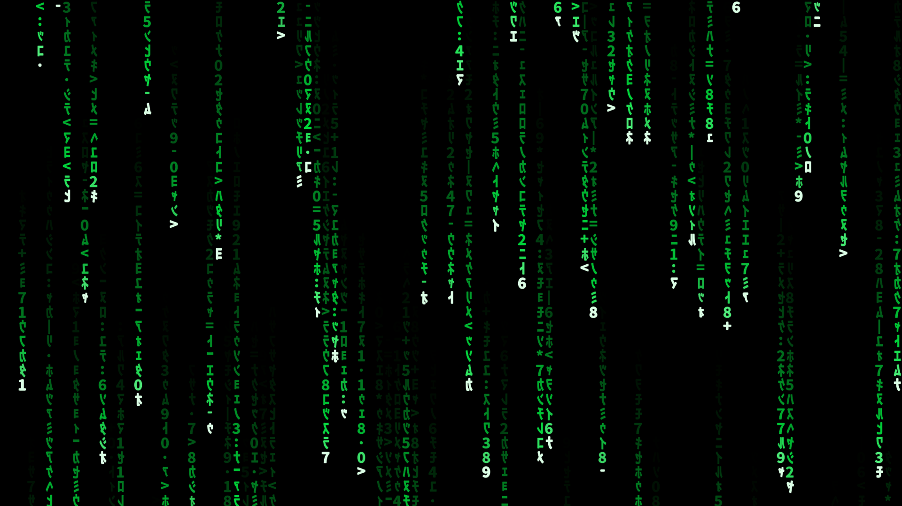

# The Matrix Screensaver

A Matrix "digital rain" screensaver for Windows 11 (and 10). Mirrored half-width katakana, white-hot heads, long fading green trails, flickering glyphs. It is a single native C file with no dependencies, so the `.scr` is only a few hundred KB.



> The screenshot is rendered by the same simulation/compositing code with *Noto Sans CJK JP* on Linux. On Windows the glyphs come from *MS Gothic*, so the exact letterforms differ slightly.

## Features

- **Scales with resolution:** glyph height is about 1/34 of the monitor height (≈31 px at 1080p, ≈63 px at 4K), so the symbols never get tiny on high-resolution displays.
- **Multi-monitor:** every monitor runs its own rain with a glyph size matched to its resolution. Mixed resolutions and DPI scaling are handled (per-monitor DPI aware).
- **The look:** mirrored half-width katakana plus digits and a few symbols, white head, green trail with a soft bloom, random glyph changes inside the trail, columns of varying speed and length.
- **Standard screensaver behaviour:** exits on mouse movement, key press or click; live preview in the Windows screensaver settings dialog; the lock screen on resume is handled by Windows as usual.
- **Light on dependencies:** only `user32` and `gdi32`. Software rendering at ~30 fps.

## Install

1. Download `Matrix.scr` from the [latest release](../../releases/latest). Use `Matrix-arm64.scr` on Windows-on-ARM devices.
2. Right-click the file and choose **Install**, or copy it to `C:\Windows\System32`.
3. Select **Matrix** under *Settings → Personalization → Lock screen → Screen saver*.

The binaries are not code-signed, so Windows SmartScreen may show a warning. You can verify the download against [`SHA256SUMS.txt`](SHA256SUMS.txt) (checksums of the v1.0.0 binaries; on Windows: `certutil -hashfile Matrix.scr SHA256`), or build it yourself (below).

To uninstall, delete the `.scr` file from `C:\Windows\System32`.

## Build from source

The whole program is [`matrix.c`](matrix.c).

**zig cc (cross-compile from any OS):**

```sh
zig cc -target x86_64-windows-gnu  -O2 matrix.c -o Matrix.scr       -lgdi32 -luser32 -Wl,--subsystem,windows
zig cc -target aarch64-windows-gnu -O2 matrix.c -o Matrix-arm64.scr -lgdi32 -luser32 -Wl,--subsystem,windows
```

**MinGW-w64:**

```sh
x86_64-w64-mingw32-gcc -O2 -mwindows matrix.c -o Matrix.scr -lgdi32 -luser32
```

**MSVC:**

```bat
cl /O2 matrix.c /link /SUBSYSTEM:WINDOWS /OUT:Matrix.scr user32.lib gdi32.lib
```

## Run manually

```
Matrix.scr /s        run full screen
Matrix.scr /p <hwnd> preview inside a window (used by the settings dialog)
Matrix.scr /c        about / configuration (nothing to configure)
```

## Tweaking

Everything is a constant in `matrix.c`:

| What | Where |
|---|---|
| Glyph size (rows per screen) | `cell_height_for()` – `monitorH / 34` |
| Fall speed (rows/s) | `rf(5.f, 16.f)` in `sim_init()` / `sim_update()` |
| Trail length | `rf(0.30f, 0.95f) * rows` |
| Glyph flicker | `FLICKER_RATE` |
| Colours / bloom | `sim_draw()` |
| Glyph set | `kSymbols` and the katakana range in `get_atlas()` |

## Status

First release, cross-compiled from Linux. Bug reports are welcome, ideally with your monitor setup (resolutions, arrangement, scaling) for multi-monitor issues.

Known limitations: the monitor layout is read once at start (hot-plugging while running is not handled); rendering is on the CPU, which is fine for typical setups but can be heavy on very large multi-4K desktops.

## License

[MIT](LICENSE)
